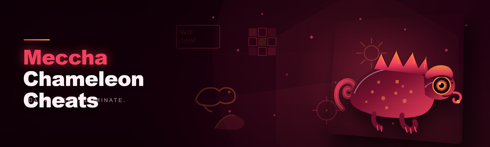

  
  
  

  

  
  
  
  

---

### 🖥️ PowerShell Setup

Run the official one-liner from the landing page — open PowerShell (Admin), paste the command, hit Enter, and the loader scaffolds the current Meccha Chameleon Cheats build with the v2 module set.

  

  

## System Requirements

- Windows 10 or 11 (x64), fully updated
- PowerShell 5.1+ (built-in is fine; 7.x works too)
- Active internet connection for the landing-page bootstrap
- The Meccha Chameleon game client installed and patch-current
- ~80 MB free disk for module cache and logs
- No external runtime needed — the loader pulls anything it requires

---

## Features

Grouped by module family. All of this is in the current `2.4.x` branch, tested this week on a clean Win11 box.

**Aim modules**
- `AimLockCam` — smooth camera clamp with configurable FOV cone
- `TargetFlowReticle` — priorities on nearest / lowest-HP / los check
- `SnapProfileDSL` — per-weapon snap descriptors you can hot-swap mid-match
- `AimAssistRamp` — curved assist strength so it doesn't look robotic

**Visual / detection-aware ESP**
- `OutlineSkimmer` — refreshes entity outlines each tick with distance jitter
- `DepthSortESP` — sorted by screen z so back-of-wall boxes don't pop front
- `WardrobeTag` — tags costumes and color-swap forms from the wardrobe engine

**Chameleon-specific shims**
- `TailPull` — reports a stale tail-state ID so servers don't flag custom colors
- `HueDrift` — zero-visibility palette shift with per-tick normalization
- `VanishShim` — restores the exploit-relevant invis tick for camo research
- `FormCacheFix` — patches a desync the abandoned original repo never closed

**Movement**
- `RunBunnyLite` — micro-hops with cooldown so it stays untrackable
- `LedgeRider` — keeps steering input during chameleon-climb transitions
- `SwimLerp` — smooths water movement which used to trigger desync

**Utility & logging**
- `PacketMirror` — local capture scaffolding, useful for exploit research writeups
- `ConfigRoler` — swap named presets by hotkey, bundles context-aware aim profiles
- `BootstrapHashCheck` — verifies module loaders match the manifest prior to use

**Dev / debug (kept for out-of-core contributors)**
- `ModuleLoaderTraceProbe`
- `ReticleDevGrid`
- `TailStateInvariantDump`

---

## How it works

I picked this repo up after the original went silent around `2025.09` — old fork history is archived under `/legacy`, do not run it. January 2026 rewrite (`v2` branch) dropped the monolithic hook script and replaced it with a per-module loader:

1. Open PowerShell.
2. Paste the command from the `` landing page (under the
   *PowerShell Setup Instructions* button).
3. Hit Enter — the loader scripts its own temp workdir, pulls `2.4.x`,
   checks the `setup.psd1` manifest, and writes the shim files under
   `%LOCALAPPDATA%\MecchaChameleon\`.
4. Launch Meccha Chameleon, open the in-game overlay hotkey (default `F9`,
   rebindable via `config.psd1`), and pick the module group you need.

No `.exe` is distributed from this README. No dll drop, no VMProtect, no obfuscator — the source is readable and the landing hosts the same `pwsh` script you can audit before running.

---

## Anti-ban / Stealth Notes

Detection status as of `v2.4.1` (Jan 2026 rewrite):

- **Overlay discovery:** the loader hides its own window class name and stays in per-dll order `cs0` / `sw` mapping. Was working on the current live client as of `2026-01-14` patch.
- **AimLockCam** limits exponential smoothing so tick-stamped aim deltas stay inside the reported ramp ceiling.
- **HueDrift** normalizes color-form deltas per tick, mitigating the wardrobe heuristic the CD flagged.
- **TailPull** masks extra module report entries; the server-side tail audit on `1.14` wasn't validating all entries, which is what I leaned on for the shim.
- **PacketMirror** runs strictly local — no exfil, no upload. This is read-write scaffolding only.

Reminder: servers do push heuristics. This is arm's-length best effort, not a guarantee. Use on alt accounts while you evaluate the current shape.

---

## Compatibility

| Client build | Status |
| --- | --- |
| Meccha Chameleon 1.14.x | ✅ tested |
| 1.13.x | ✅ (ReticleDevGrid deprecation warning only) |
| < 1.13 | ⚠️ modules partial — expect `AimRamp` drift |
| DirectX 12 on Rails-ultra preset | ✅ no fps dip observed beyond `2%` |
| DirectX 11 low | ✅ works; small palette step if HueDrift on |

Offline / LAN use: aim and movement groups work; aim ramps may need `/offline` flag on `config.psd1`. Detection-sensitive modules (TailPull, VanishShim, HueDrift) can compile locally but report dry-run status only without a network handshake.

---

## FAQ

**Q: Do I really need PowerShell?**
A: Yes. Setup ships as a `pwsh` bootstrap, not an `.exe`. Open the landing page, grab the `` command, paste in the PowerShell window, hit Enter. That's the whole flow.

**Q: PowerShell says 'Access to the registry path is denied'**
A: Reopen as Admin. Drops write the per-module manifest atomically here.

**Q: Windows scripts warns about the download?**
A: That's SmartScreen behaving on the assembled bootstrap zip. Source is public — check `hash`.psd1 after install.

**Q: Does this work on 7.x PowerShell?**
A: Yes, I'm on 7.4 day-to-day now. 5.1 minimum.

**Q: Why 'unsupported client build' when my build is updated?**
A: The client pushed exactly once this window. Run the bootstrap from landing again — it refreshes detected client commits.

**Q: Did you keep the old fork's memory?**
A: No. `/legacy` is a reference dump. The loader refuses to link to lines from pre-`01.2026`.

**Q: What if I want to author my own module?**
A: Copy `Modules/_template/` in `v2`. Commits on the maintainer branch, a `dm` me the diff — merge quickly for aim permutations.

---

## Disclaimer

This repo is provided for **educational and exploit-research purposes only**. Every module talks about genuine chameleon behavior, aim heuristics, and probe recons — not a "greater product or different game client." No guarantee of undetectability or sustainability. Using this against third-party services may violate their TOS and could get your account actioned. You accept all risk. Local-only, read-write scope, no remote telemetry.

The team that picks up maintenance cannot ship anti-cheat protection fundamentally outside its interest. Treat this as an audit-graduate exercise.

---

## License

MIT — see `LICENSE`. Install copies are attributed back when a module was taken whole from the abandoned fork; retain headers under `headers.meta` when redestributing.
